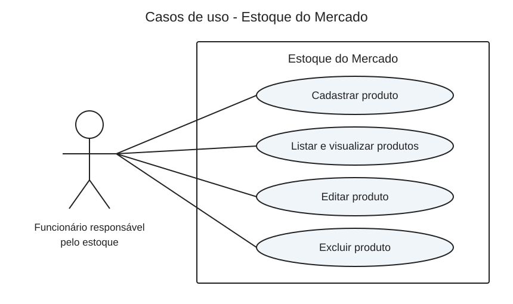

# Casos de uso - Estoque do Mercado

## Ator

**Funcionário responsável pelo estoque:** pessoa que cadastra e mantém as informações dos produtos do mercado. O proprietário pode exercer esse mesmo papel.

Há um único ator, pois o sistema não tem login nem permissões diferentes.
O banco de dados faz parte da implementação do sistema e não é um ator.

## Diagrama

O retângulo representa o sistema; as elipses representam as ações e as linhas ligam o funcionário às ações disponíveis.

## UC01 - Cadastrar produto

- Ator: funcionário responsável pelo estoque.
- Objetivo: adicionar um produto.
- Pré-condição: sistema e banco disponíveis.
- Fluxo principal:
  1. O funcionário abre a listagem e clica em Cadastrar produto.
  2. O sistema mostra o formulário.
  3. O funcionário informa nome, categoria, descrição, preço, quantidade e validade.
  4. O funcionário clica em Salvar.
  5. O sistema valida os dados e grava o produto.
  6. O sistema volta à listagem e informa o sucesso.
- Alternativas: campos inválidos ou token inválido geram uma mensagem; os dados digitados ficam no formulário para correção. Cancelar volta à lista sem salvar.
- Pós-condição: produto cadastrado com identificação automática.

## UC02 - Listar e visualizar produtos

- Ator: funcionário responsável pelo estoque.
- Objetivo: consultar o estoque.
- Pré-condição: sistema e banco disponíveis.
- Fluxo principal:
  1. O funcionário abre a página inicial.
  2. O sistema consulta os produtos.
  3. O sistema exibe nome, categoria, descrição, preço, quantidade e validade.
  4. O funcionário pode escolher Editar ou Excluir na linha de um produto.
- Alternativa: se não houver produtos, o sistema informa que nenhum produto está cadastrado.
- Pós-condição: informações exibidas, sem mudanças no banco.

## UC03 - Editar produto

- Ator: funcionário responsável pelo estoque.
- Objetivo: corrigir ou atualizar as informações de um produto.
- Pré-condição: produto cadastrado e banco disponível.
- Fluxo principal:
  1. O funcionário clica em Editar na listagem.
  2. O sistema busca o produto e preenche o formulário.
  3. O funcionário altera os campos e clica em Salvar.
  4. O sistema valida e atualiza os dados.
  5. O sistema retorna à listagem e informa o sucesso.
- Alternativas: dados inválidos mantêm o formulário para correção. ID inválido ou produto inexistente geram uma mensagem. Cancelar não salva mudanças.
- Pós-condição: informações atualizadas, mantendo o mesmo ID.

## UC04 - Excluir produto

- Ator: funcionário responsável pelo estoque.
- Objetivo: remover um registro do estoque.
- Pré-condição: produto cadastrado e banco disponível.
- Fluxo principal:
  1. O funcionário clica em Excluir na listagem.
  2. O sistema mostra o nome do produto e solicita confirmação.
  3. O funcionário clica em Confirmar exclusão.
  4. O sistema valida o envio e exclui o registro.
  5. O sistema retorna à lista e informa o sucesso.
- Alternativas: Cancelar mantém o registro. Token inválido impede a exclusão. ID inválido ou produto inexistente geram uma mensagem.
- Pós-condição: produto removido do banco.

## Tratamento comum de erros

Se uma operação no banco falhar, o sistema mostra uma mensagem de erro sem apresentar o comando SQL ou detalhes da conexão. O erro técnico fica no log do PHP. A página não informa sucesso quando a operação falha.

## Limites do sistema

Não inclui vendas, fornecedores, movimentações de entrada e saída, relatórios ou autenticação.
A quantidade atual é informada no cadastro ou ajustada na edição.
